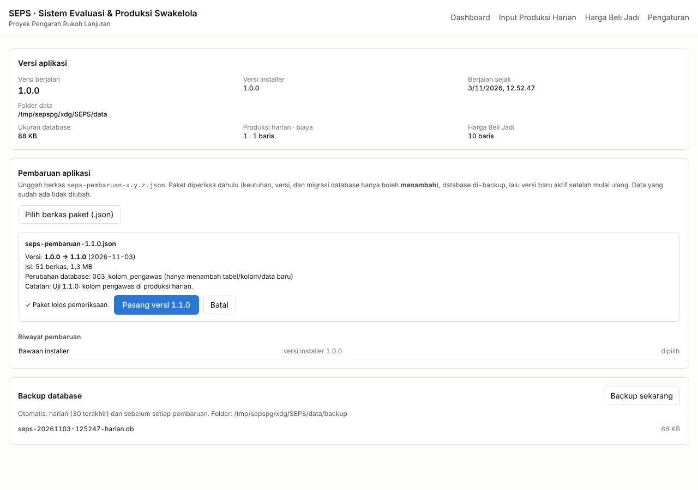

# Panduan Aplikasi Desktop SEPS

SEPS terpasang di komputer seperti aplikasi biasa. Server ikut **berjalan otomatis** saat aplikasi dibuka, jadi tidak perlu server atau internet. Pembaruan dilakukan dengan **mengunggah satu berkas paket** dari menu Pengaturan, dan **data lama tidak diubah**.



## 1. Memasang (sekali saja)

1. Unduh `SEPS-Setup-<versi>.exe`. Sumbernya:
   - GitHub › tab **Actions** › jalankan *SEPS Desktop* terbaru › **Artifacts › SEPS-windows**, atau
   - **Releases**, bila sudah ada tag rilis.
2. Jalankan installer, pilih folder (boleh bawaan), lalu klik **Install**. Shortcut **SEPS** dibuat di Desktop dan Start Menu.
3. Buka SEPS. Saat pertama kali dibuka, database dibuat otomatis berisi:
   - 9 item swakelola, tarif sumber daya, dan parameter evaluasi (overhead 3%, mingguan Senin–Minggu),
   - harga Beli Jadi **contoh**.

> Windows SmartScreen bisa memperingatkan "unrecognized app" karena installer belum ditandatangani sertifikat code-signing. Pilih **More info › Run anyway**.

Opsi: menu **Berkas › Jalankan saat komputer menyala** agar SEPS dan servernya langsung aktif setelah login.

## 2. Lokasi data

| Isi | Lokasi (Windows) |
|---|---|
| Database | `%APPDATA%\SEPS\data\seps.db` |
| Backup | `%APPDATA%\SEPS\data\backup\` (harian, 30 terakhir + otomatis sebelum setiap pembaruan) |
| Kode hasil pembaruan | `%APPDATA%\SEPS\kode\<versi>\` |
| Log | `%APPDATA%\SEPS\logs\seps.log` |

Buka cepat: menu **Berkas › Buka folder data & backup**.

Data **tidak** terhapus saat aplikasi di-uninstall atau saat installer versi baru dipasang.

## 3. Memperbarui aplikasi (unggah paket)

1. Terima berkas `seps-pembaruan-<versi>.json`, misalnya `seps-pembaruan-1.1.0.json`.
2. Buka SEPS › **Pengaturan** › **Pilih berkas paket (.json)**.
3. SEPS memeriksa paket **tanpa mengubah apa pun**:
   - keutuhan setiap berkas (checksum SHA-256),
   - versinya harus lebih baru dari versi yang berjalan,
   - migrasi database **hanya boleh menambah** (tabel/kolom/data baru). Perintah yang mengubah atau menghapus data (UPDATE, DELETE, DROP, REPLACE, dll.) ditolak,
   - migrasi dicoba dulu pada **salinan** database.
4. Bila lolos, klik **Pasang versi x.y.z**. Database di-backup, lalu kode baru disimpan.
5. Klik **Mulai ulang sekarang**. SEPS terbuka kembali dengan versi baru.

Bila paket ditolak, alasannya ditampilkan dan tidak ada yang berubah.

### Pengaman otomatis

- **Versi baru gagal dijalankan** → SEPS otomatis kembali ke versi sebelumnya dan menampilkan peringatan. Data tidak berubah.
- **Kembali ke versi lama secara manual**: di Riwayat pembaruan, klik **Pakai versi ini** atau **Kembalikan ke bawaan**, lalu mulai ulang. Ini aman karena migrasi hanya menambah, sehingga kode versi lama tetap bisa membaca database yang lebih baru.

### Pembaruan installer

Paket JSON memperbarui seluruh logika server dan tampilan. Installer `.exe` baru hanya diperlukan bila paket menyebut "butuh aplikasi (installer) minimal …", misalnya saat versi Electron atau modul npm berubah. Pasang `.exe` baru di atas yang lama; data tetap utuh.

## 4. Memulihkan dari backup

1. Tutup SEPS.
2. Buka `%APPDATA%\SEPS\data\`, lalu ganti nama `seps.db` menjadi `seps-sebelum-pulih.db` (simpan, jangan dihapus).
3. Salin berkas backup dari `backup\` ke folder `data\`, lalu ganti namanya menjadi `seps.db`.
4. Buka SEPS.

## 5. Harga Beli Jadi

Menu **Harga Beli Jadi** › isi item, vendor, No. SPH, harga franco lokasi (belum termasuk PPN), dan biaya angkut bila belum franco.

Opsi **"Akhiri harga lama item ini"** (aktif bawaan) mengakhiri harga contoh. Ini penting karena Decision Engine memakai harga terendah yang masih berlaku: tanpa opsi ini, harga contoh yang lebih murah tetap terpilih.

## 6. Untuk pengembang: membuat paket pembaruan

1. Ubah kode di `seps/backend/src` dan/atau `seps/frontend`.
2. Perubahan database → tambahkan berkas **baru**, misalnya `seps/backend/migrasi/sqlite/003_nama.sql`. Isinya hanya boleh:
   - `CREATE TABLE IF NOT EXISTS …`
   - `CREATE [UNIQUE] INDEX IF NOT EXISTS …`
   - `ALTER TABLE … ADD COLUMN …`
   - `INSERT OR IGNORE INTO …`
   - `CREATE VIEW IF NOT EXISTS …` / `DROP VIEW IF EXISTS …`

   Berkas migrasi lama **tidak boleh diubah**; paket akan ditolak.
3. Naikkan `versi` di `seps/versi.json` dan isi `catatan`. Naikkan `untukShell` hanya bila butuh installer baru.
4. Buat paket dengan perintah di bawah. Hasilnya `seps/dist/seps-pembaruan-<versi>.json`.

```bash
cd seps/frontend && npm ci && npm run build
```

```bash
node seps/alat/buat-paket.js
```

Atau cukup push ke GitHub: workflow **SEPS Desktop** menguji kode, membangun installer, lalu membuat paket (Artifacts **SEPS-windows**).

Arsitektur singkat:
- `seps/desktop/main.js` (shell Electron, jarang berubah) memilih folder kode: versi pilihan → versi terpasang lain → bawaan installer.
- Shell lalu menjalankan `backend/src/desktop.js` dari folder kode itu. File ini menerapkan migrasi, membuat backup, dan menjalankan server di `127.0.0.1:4780`. Server hanya bisa diakses dari komputer ini, dan perubahan data wajib header `X-SEPS-Klien`.
- Uji: `seps/backend/test/desktop.test.js` (alur pasang → mulai ulang → data identik, 6 jenis paket berbahaya ditolak, kembali ke bawaan) dan `seps/desktop/test/pemilih-kode.test.js`.
