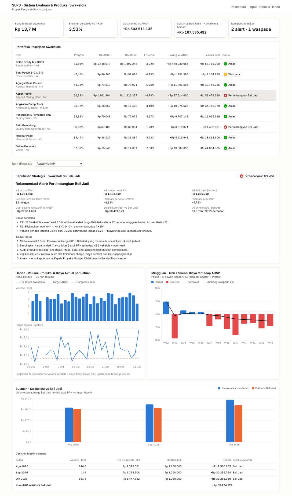

# Spesifikasi Teknis — SEPS (Sistem Evaluasi & Produksi Swakelola)

| | |
|---|---|
| Versi dokumen | 0.1 (boilerplate awal) |
| Proyek acuan | Pengarah Rukoh Lanjutan (`PRJ-RUKOH-2026`) |
| Sumber data acuan | Spreadsheet monitoring "Swakeloal": sheet `DASHBOARD_EVALUASI`, `App_Architecture_Schema`, `Batching Plant`, `GALIAN`, `Web_App_UI` |
| Kode | `seps/backend` (Express + PostgreSQL), `seps/frontend` (Next.js + Tailwind + Recharts), `seps/database` (DDL + seed) |



---

## 1. Tujuan & ruang lingkup

SEPS memonitor produksi harian unit-unit swakelola (Batching Plant, Stone Crusher, Agregat, AMP, Angkutan, Quarry Sirtu, Batu Gelondong, Hampar Padat, Galian) dan menjawab satu pertanyaan manajerial secara otomatis setiap tutup periode:

> **Apakah Swakelola masih lebih ekonomis daripada Beli Jadi (outsourcing / pembelian pihak ketiga)?**

Ruang lingkup versi ini:

1. Master data terpusat (item, sumber daya, koefisien AHSP/JMF, parameter).
2. Input produksi harian + biaya aktual (material, alat, upah, BBM, overhead lain).
3. Benchmark harga Beli Jadi (SPH vendor).
4. Agregasi harian / mingguan / bulanan + metrik efisiensi & cost saving.
5. Decision Engine dengan alert "Pertimbangkan Beli Jadi".
6. Dashboard analitik (3 grafik + panel keputusan + tabel portofolio).

Di luar lingkup v0.1 (lihat §10 Roadmap): autentikasi/otorisasi, alur approval, impor Excel, notifikasi WA/email.

## 2. Temuan dari spreadsheet acuan (dasar desain)

| # | Temuan | Konsekuensi desain |
|---|---|---|
| 1 | `DASHBOARD_EVALUASI` merangkum 9 pekerjaan dengan Harga Satuan Analisis vs Aktual, efisiensi 1–6 %. Pola efisiensinya bulat (4,0 %, 3,0 %, 2,0 %…) → kemungkinan masih angka asumsi, belum dari transaksi. | SEPS menghitung HS aktual **dari transaksi harian** (produksi + biaya), bukan input manual. |
| 2 | Batching Plant: "Biaya Produksi" Rp 356.819/m³ hanya **operasional** (biaya alat 8 bulan ÷ 26.762 m³); HPP total K350 = Rp 1.448.977/m³ (bahan + operasional). | Untuk dibandingkan dengan harga ready-mix Beli Jadi (sudah termasuk material), `hs_ahsp` BP memakai **HPP total**. Kalau tidak, perbandingan tidak apple-to-apple. |
| 3 | Biaya BP dihitung per bulan (sewa alat 200 jam/bulan) lalu dibagi volume rencana. Bila volume aktual di bawah rencana, HS riil naik — tidak terlihat di sheet. | Biaya dicatat per hari dan dipisah **tetap vs variabel** → SEPS menghitung **volume impas (BEP)**. |
| 4 | Harga solar berbeda antar sheet (BP Rp 18.000, GALIAN Rp 11.500/ltr). | Tarif disimpan sekali di `m_sumber_daya` (single source of truth). |
| 5 | `Batching Plant` kapasitas produksi per hari = `#ERROR!`; `Web_App_UI` menampilkan 116,4 m³/hari. | Kapasitas jadi kolom `m_unit_produksi.kapasitas_harian`, bukan rumus sel. |
| 6 | `App_Architecture_Schema` sudah merancang `m_material`, `m_alat`, `t_produksi_log`. | Dipertahankan & diperluas: `m_sumber_daya` (gabungan material/alat/upah), `t_produksi_harian`, `t_biaya_aktual`, `t_benchmark_beli_jadi`. |

## 3. Arsitektur

```
┌────────────────────────────┐        HTTPS/JSON         ┌──────────────────────────────────────┐
│ Frontend — Next.js 14      │ ───────────────────────▶  │ Backend — Node.js 18+ / Express 4    │
│  • Tailwind CSS            │                           │  routes (app.js)                      │
│  • Recharts 2              │ ◀───────────────────────  │   └─ services/analitik.js             │
│  • /  Dashboard            │                           │        ├─ agregasi.js   (periode, HS) │
│  • /input Form harian      │                           │        └─ decisionEngine.js (R1/R2,BEP)│
└────────────────────────────┘                           │  repositories/ pgRepo | memoryRepo    │
                                                         └──────────────┬───────────────────────┘
                                                                        │ SQL
                                                         ┌──────────────▼───────────────────────┐
                                                         │ PostgreSQL 14+                        │
                                                         │  m_* master · t_* transaksi · v_* view│
                                                         └───────────────────────────────────────┘
```

**Pilihan teknologi**

| Lapisan | Pilihan | Alasan |
|---|---|---|
| Backend | Node.js + Express | Satu bahasa (JavaScript) dengan frontend; Decision Engine berupa fungsi murni yang bisa dipakai ulang di server, job terjadwal, maupun uji unit. FastAPI setara bila tim lebih kuat di Python — logika di `services/` mudah diporting 1:1. |
| Database | PostgreSQL | `ENUM`, `FILTER`, `date_trunc('week')` ISO, `JSONB` untuk log keputusan, constraint `CHECK`. MySQL 8 bisa dipakai dengan menyesuaikan ENUM & view. |
| Frontend | Next.js (App Router) + Tailwind + Recharts | Komponen grafik deklaratif, SSR opsional, mudah di-deploy (Vercel/Docker/Nginx). |
| Pola repository | `pgRepo` / `memoryRepo` | API bisa jalan tanpa DB (mode demo & uji); produksi memakai PostgreSQL. |

**Prinsip perhitungan**

- Semua harga **excl. PPN** (PPN masukan dapat dikreditkan → netral terhadap keputusan).
- Harga Beli Jadi = **harga landed** = harga satuan vendor + biaya angkut ke lokasi.
- Swakelola dibandingkan setelah ditambah **overhead** (`m_item.overhead_pct`, default 5 %): biaya pengawasan, mess, penyusutan, risiko — karena harga vendor sudah memuat overhead & laba mereka.
- Agregasi dilakukan di aplikasi (fungsi murni, teruji); view SQL `v_evaluasi_*` menghasilkan angka yang sama untuk BI/ekspor (diverifikasi: AMP W44 efisiensi −8,13 % di keduanya).

## 4. Skema database

DDL lengkap: [`database/001_schema.sql`](../database/001_schema.sql) · Seed master dari spreadsheet: [`database/002_seed_master.sql`](../database/002_seed_master.sql)

```
m_proyek 1─┐
           └─< m_unit_produksi 1─< m_item 1─┬─< t_produksi_harian      (item, tanggal, shift) UNIQUE
                                            ├─< t_biaya_aktual         kategori: MATERIAL|ALAT|UPAH|BBM|OVERHEAD_LAIN
                                            ├─< t_benchmark_beli_jadi  harga landed, masa berlaku, lolos spek
                                            ├─< m_koefisien_ahsp >─ m_sumber_daya (tarif standar, sifat TETAP/VARIABEL)
                                            └─< t_rekomendasi          snapshot keputusan + keputusan manajemen
m_parameter_evaluasi (key-value: periode_berturut, ambang_waspada_pct, granularitas, metode_benchmark)
```

| Tabel | Isi | Kolom kunci |
|---|---|---|
| `m_item` | **Master Item** swakelola | `kode`, `satuan`, `volume_rencana`, `hs_ahsp` (target), `overhead_pct` |
| `m_sumber_daya` | Material, alat, upah, BBM, utilitas | `kategori`, `sifat` (TETAP/VARIABEL), `tarif_standar` |
| `m_koefisien_ahsp` | Koefisien AHSP / JMF per item | `koefisien`, `waste_pct` (mis. K350: semen 520 kg, waste 2 %) |
| `t_produksi_harian` | **Input Produksi Harian** | `volume`, `jam_kerja`, `ritase`, `bbm_liter`, `cuaca`, `status` approval |
| `t_biaya_aktual` | **Biaya Aktual** (Material, Alat, Upah, BBM, Overhead lain) | `kategori`, `qty × harga_satuan = jumlah` (CHECK), `no_dokumen` (BPB/timesheet/kupon BBM) |
| `t_benchmark_beli_jadi` | **Benchmark Harga Beli Jadi** | `harga_satuan`, `biaya_angkut_per_satuan`, `berlaku_mulai/sampai`, `memenuhi_spesifikasi` |
| `t_rekomendasi` | Log hasil Decision Engine per periode | `status`, `payload JSONB`, `keputusan_manajemen` |

View: `v_harian` (produksi ⨝ biaya per hari, pivot kategori), `v_evaluasi_mingguan`, `v_evaluasi_bulanan`; fungsi `f_harga_beli_jadi(item, mulai, selesai)`.

## 5. Definisi metrik

Untuk satu item dan satu periode *p* (hari / minggu ISO Senin–Minggu / bulan kalender):

| Metrik | Rumus |
|---|---|
| Biaya aktual | `B = Σ material + alat + upah + bbm + overhead_lain` |
| HS aktual | `HSa = B / V` (null bila V = 0) |
| HS efektif swakelola | `HSe = HSa × (1 + OH)` |
| HS Beli Jadi | `HBJ = min(harga + angkut)` dari SPH yang berlaku & lolos spek (atau rata-rata, sesuai parameter) |
| Efisiensi vs AHSP | `E = (HSahsp × V − B) / (HSahsp × V) × 100 %` ; V = 0 dan B > 0 → −100 % (alat idle) |
| Cost saving / overrun vs AHSP | `CS = HSahsp × V − B` (positif = hemat) |
| Selisih vs Beli Jadi | `Δ = HBJ × V − B × (1 + OH)` (positif = swakelola lebih hemat) |
| Kumulatif | penjumlahan berjalan V, B, biaya AHSP, biaya Beli Jadi sejak awal rentang |
| Volume impas (BEP) | `Q* = F(1+OH) / (HBJ − v(1+OH))`, F = biaya tetap periode (alat, upah, overhead lain), v = biaya variabel per satuan (material, BBM). Bila penyebut ≤ 0 → swakelola tidak pernah kompetitif. |

## 6. Decision Engine — "Swakelola vs Beli Jadi"

Kode: [`backend/src/services/decisionEngine.js`](../backend/src/services/decisionEngine.js) · Uji: [`backend/test/decisionEngine.test.js`](../backend/test/decisionEngine.test.js)

```
INPUT : deret periode (default mingguan) hasil agregasi, parameter
N     = periode_berturut (default 3)

streak ← jumlah periode aktif TERAKHIR berturut-turut dengan HSe > HBJ
         (periode V = 0 tetapi ada biaya dihitung "lebih mahal"; periode tanpa benchmark memutus streak)

R1 ← streak ≥ N
R2 ← Efisiensi periode terakhir < 0 %

STATUS ← ALERT_BELI_JADI  jika R1 atau R2        → "Rekomendasi Alert: Pertimbangkan Beli Jadi"
         WASPADA          jika streak ≥ 1 atau 0 ≤ E < ambang_waspada_pct (2 %)
         AMAN             selain itu
         DATA_KURANG      bila belum ada transaksi
```

Output selain status: alasan (kalimat siap pakai di memo), daftar tindak lanjut, metrik real-time (HS aktual/efektif/Beli Jadi, streak, efisiensi periode & kumulatif, cost saving kumulatif, selisih kumulatif vs Beli Jadi, potensi hemat periode terakhir, volume impas & % utilisasi).

**Catatan pengambilan keputusan.** Alert adalah *pemicu kajian*, bukan keputusan final. Sebelum beralih ke Beli Jadi, pertimbangkan: (a) biaya demobilisasi & minimum charge kontrak sewa alat, (b) kepastian pasokan & kapasitas vendor terhadap jadwal kritis, (c) mutu (uji slump/kuat tekan, gradasi, kepadatan) dan tanggung jawab bila reject, (d) opsi hybrid — sebagian volume dibeli jadi untuk menaikkan utilisasi alat sendiri ke atas volume impas.

**Parameter yang bisa diatur** (`m_parameter_evaluasi`, tanpa deploy ulang): `periode_berturut`, `ambang_waspada_pct`, `granularitas` (harian terlalu sensitif terhadap hujan; mingguan direkomendasikan), `metode_benchmark` (`TERENDAH` / `RATA_RATA`).

## 7. Dashboard & UI/UX

```
┌──────────────────────────────────────────────────────────────────────────────┐
│ KPI: Biaya realisasi │ Efisiensi portofolio │ Cost saving │ Selisih vs BJ │ Alert│
├──────────────────────────────────────────────────────────────────────────────┤
│ Tabel Portofolio 9 item: progres, HS AHSP, HS aktual, efisiensi, status ✓ ! ▲ │  ← klik baris = pilih item
├──────────────────────────────────────────────────────────────────────────────┤
│ Panel Keputusan Strategis: status, rekomendasi, metrik, dasar penilaian, TL   │
├───────────────────────────────────────┬──────────────────────────────────────┤
│ HARIAN (30 hari)                      │ MINGGUAN                             │
│  panel atas : batang volume           │  batang efisiensi % (biru/merah)     │
│  panel bawah: garis HS aktual         │  garis efisiensi kumulatif           │
│   + garis putus AHSP & Beli Jadi      │  garis 0 % & ambang waspada          │
├───────────────────────────────────────┴──────────────────────────────────────┤
│ BULANAN: batang Swakelola+OH vs Beli Jadi per bulan + Decision Matrix bulanan │
└──────────────────────────────────────────────────────────────────────────────┘
```

Keputusan desain grafik:

- **Tidak memakai dual-axis.** Volume (m³/Ton) dan Rp/satuan beda besaran → dua panel bertumpuk dengan sumbu-X & tooltip tersinkron (`syncId`). Dual-axis membuat kesan korelasi yang tergantung skala pilihan.
- Warna mengikuti peran, konsisten di semua grafik: biru = Swakelola, oranye = Beli Jadi, abu putus-putus = target AHSP; efisiensi memakai skema diverging biru (hemat) ↔ merah (overrun).
- Status selalu **ikon + label** (✓ Aman, ! Waspada, ▲ Pertimbangkan Beli Jadi), tidak bergantung warna saja.
- Mode gelap memakai token warna sendiri (`app/globals.css`), bukan inversi otomatis.
- "Real-time": dashboard memuat ulang tiap 60 detik; setiap `POST /produksi-harian` langsung mengembalikan hasil evaluasi terbaru.

## 8. REST API (`/api/v1`)

| Method | Endpoint | Fungsi |
|---|---|---|
| GET | `/kesehatan` | status & jenis penyimpanan |
| GET | `/items` | master item |
| POST | `/produksi-harian` | input produksi + biaya harian (upsert per item/tanggal/shift) → kembalikan keputusan terbaru |
| GET | `/produksi-harian?item_id&dari&sampai` | log produksi |
| POST | `/benchmark` · GET `/benchmark?item_id` | harga penawaran Beli Jadi |
| GET | `/analitik/harian?item_id&dari&sampai` | deret harian (grafik harian) |
| GET | `/analitik/mingguan?item_id&dari&sampai` | deret mingguan ISO (grafik efisiensi) |
| GET | `/analitik/bulanan?item_id&dari&sampai` | deret bulanan (perbandingan & decision matrix) |
| GET | `/keputusan/:item_id?granularitas` | hasil Decision Engine |
| GET | `/dashboard/ringkasan` | portofolio semua item + KPI |

### Contoh — input produksi harian

```http
POST /api/v1/produksi-harian
Content-Type: application/json

{
  "item_id": 9,
  "tanggal": "2026-11-02",
  "shift": 1,
  "volume": 250,
  "jam_kerja": 8,
  "cuaca": "CERAH",
  "catatan": "Galian saluran STA 2+100 – 2+250",
  "biaya": [
    { "kategori": "BBM",  "sumber_daya_kode": "EBM-01", "qty": 128, "harga_satuan": 18000, "no_dokumen": "KPN-0912" },
    { "kategori": "ALAT", "sumber_daya_kode": "ALT-01", "qty": 8,   "harga_satuan": 210000, "no_dokumen": "TS-EXC-0311" },
    { "kategori": "UPAH", "keterangan": "Operator + surveyor + helper + mekanik", "jumlah": 1080000 }
  ]
}
```

Respons `201 Created` (upsert ulang → `200 OK`): `{ "data": { "produksi": {...}, "biaya": [...] }, "keputusan": { "status": "AMAN", ... } }`.
Validasi gagal → `422` dengan `galat: [{ "field": "tanggal", "pesan": "format YYYY-MM-DD" }]`.

### Contoh — agregasi mingguan (`GET /analitik/mingguan?item_id=4`, satu elemen)

```json
{
  "periode": "2026-W44", "label": "W44", "mulai": "2026-10-26", "selesai": "2026-11-01",
  "volume": 38.46, "jam_kerja": 46.9, "hari_kerja": 6,
  "biaya": { "material": 25259048, "alat": 15932583, "upah": 3414126, "bbm": 4457479, "overhead_lain": 3414126 },
  "biaya_total": 52477362, "biaya_total_dengan_overhead": 55101230,
  "hs_ahsp": 1261904, "hs_aktual": 1364465.99, "hs_efektif": 1432689.29, "hs_beli_jadi": 1260000,
  "efisiensi_pct": -8.13, "cost_saving_vs_ahsp": -3944534,
  "biaya_jika_beli_jadi": 48459600, "selisih_vs_beli_jadi": -6641630, "swakelola_lebih_mahal": true,
  "kumulatif": { "volume": 455.14, "biaya_swakelola": 601857647, "efisiensi_pct": -4.79,
                 "cost_saving_vs_ahsp": -27514660, "selisih_vs_beli_jadi": -58474129, "...": "..." }
}
```

### Contoh — keputusan (`GET /keputusan/4`)

```json
{
  "status": "ALERT_BELI_JADI",
  "rekomendasi": "Rekomendasi Alert: Pertimbangkan Beli Jadi",
  "alasan": [
    "R1: HS Swakelola + overhead 5.0% lebih mahal dari harga Beli Jadi selama 12 periode mingguan berturut-turut (batas 3).",
    "R2: Efisiensi periode W44 = -8.13% (< 0%, overrun terhadap AHSP).",
    "Volume periode terakhir 38.46 baru 72.2% dari volume impas 53.26 — biaya tetap alat/upah belum tertutup."
  ],
  "aturan": { "r1_beli_jadi_lebih_murah_berturut": true, "r2_efisiensi_negatif": true },
  "metrik": {
    "streak_lebih_mahal": 12, "hs_aktual": 1364465.99, "hs_efektif": 1432689.29, "hs_beli_jadi": 1260000,
    "efisiensi_periode_terakhir_pct": -8.13, "efisiensi_kumulatif_pct": -4.79,
    "cost_saving_kumulatif_vs_ahsp": -27514660, "selisih_kumulatif_vs_beli_jadi": -58474129,
    "potensi_hemat_beli_jadi_periode_terakhir": 6641630,
    "volume_impas": { "volume": 53.26, "volume_aktual": 38.46, "rasio_utilisasi_pct": 72.2 }
  }
}
```

## 9. Peta kode

| File | Isi |
|---|---|
| `backend/src/services/periode.js` | kunci periode harian / minggu ISO / bulan (tanpa geser zona waktu) |
| `backend/src/services/agregasi.js` | agregasi + seluruh metrik §5 + pemilihan harga Beli Jadi |
| `backend/src/services/decisionEngine.js` | aturan R1/R2, status, BEP, alasan & tindak lanjut |
| `backend/src/services/analitik.js` | orkestrasi repo → agregasi → engine; ringkasan portofolio |
| `backend/src/app.js` | rute REST + penanganan galat |
| `backend/src/validasi.js` | validasi input (tanggal, volume ≥ 0, kategori, qty × harga) |
| `backend/src/repositories/*.js` | PostgreSQL & in-memory, antarmuka sama |
| `backend/src/data/master.js` | master dari spreadsheet + benchmark **contoh** |
| `backend/src/data/demo.js` | generator data demo 13 minggu (deterministik) |
| `frontend/components/charts/DailyOutputCostChart.jsx` | grafik harian (2 panel tersinkron) |
| `frontend/components/charts/WeeklyEfficiencyChart.jsx` | grafik efisiensi mingguan |
| `frontend/components/charts/MonthlyComparisonChart.jsx` | grafik bulanan + decision matrix |
| `frontend/components/DecisionPanel.jsx` | panel keputusan strategis |
| `frontend/app/input/page.jsx` | formulir input produksi harian |

Potongan inti komponen grafik harian (Recharts):

```jsx
<ResponsiveContainer width="100%" height={140}>
  <BarChart data={data} syncId="harian">
    <YAxis tickFormatter={(v) => angka(v)} />
    <Tooltip content={<TooltipKustom isi={isi} />} />
    <Bar dataKey="volume" fill="var(--series-1)" radius={[4, 4, 0, 0]} />
  </BarChart>
</ResponsiveContainer>
<ResponsiveContainer width="100%" height={200}>
  <LineChart data={data} syncId="harian">
    <XAxis dataKey="label" />
    <YAxis tickFormatter={rupiahRingkas} domain={['auto', 'auto']} />
    <Tooltip content={<TooltipKustom isi={isi} />} />
    <ReferenceLine y={item.hs_ahsp} stroke="var(--text-secondary)" strokeDasharray="4 3" />
    <ReferenceLine y={hsBeliJadi} stroke="var(--series-2)" strokeDasharray="4 3" />
    <Line type="linear" dataKey="hs_aktual" stroke="var(--series-1)" strokeWidth={2} dot={false} connectNulls={false} />
  </LineChart>
</ResponsiveContainer>
```

## 10. Roadmap implementasi

| Tahap | Lingkup |
|---|---|
| v0.1 (ini) | Skema, API, Decision Engine + uji, dashboard 3 grafik, form input, data demo |
| v0.2 | Login & peran (Pelaksana input, Site Engineer verifikasi, Kepala Proyek approve); hanya data `DISETUJUI` yang masuk evaluasi; audit trail |
| v0.3 | Impor Excel/Google Sheets dari format spreadsheet lama; ekspor laporan mingguan PDF/Excel |
| v0.4 | Job tutup periode (cron Senin 06:00 WIB) → simpan `t_rekomendasi`, notifikasi WA/email ke Kepala Proyek bila ALERT |
| v0.5 | Kontrol pemakaian material vs koefisien JMF (semen aktual vs 520 kg/m³ K350 + waste), BBM/jam vs standar alat |
| v1.0 | Multi-proyek, perbandingan antar proyek, benchmark harga regional |

## 11. Menjalankan

Lihat [`../README.md`](../README.md).
